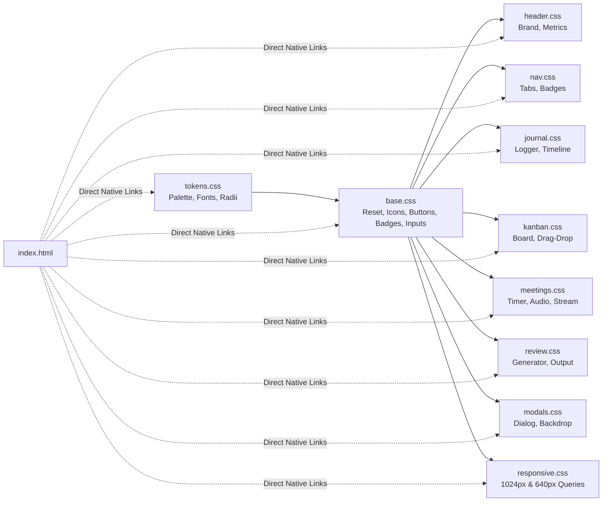
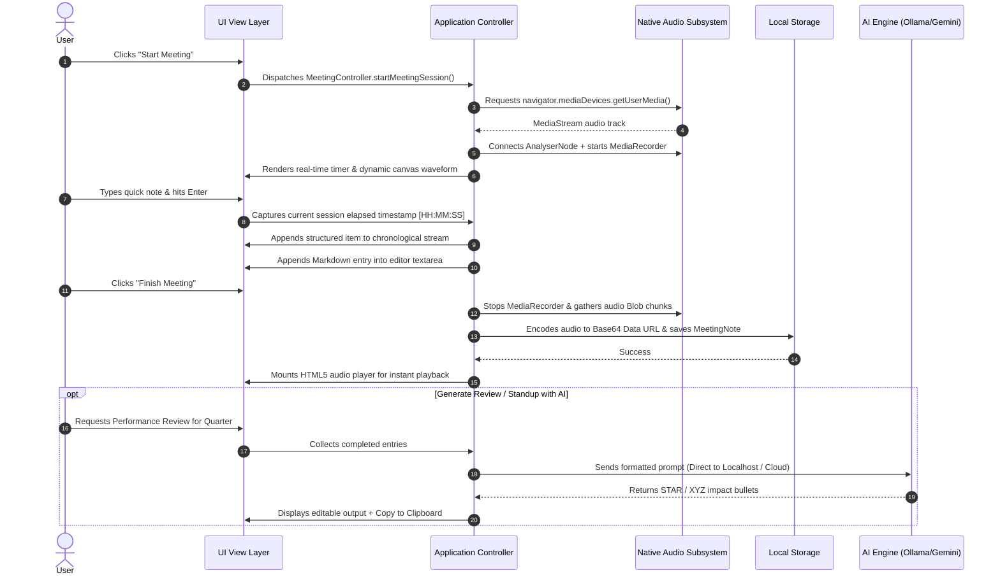
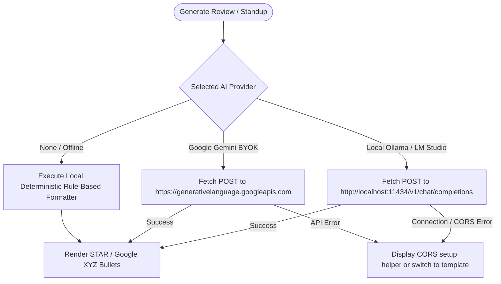

# 🏗️ BragBook Architecture & Technical Design

This document details the architectural specifications, data structures, and integration patterns for **BragBook v1.2.0**.

---

## 1. High-Level Architecture

BragBook follows an **Offline-First, Zero-Server Client Architecture**. The application executes entirely within the browser context and interacts directly with browser storage APIs, audio hardware, and local/cloud AI endpoints.

```mermaid
graph TD
    User([User / Browser Viewport])

    subgraph Client [BragBook Client (Browser Runtime)]
        UI[Semantic UI & High-Density Corporate ERP View Layer]
        AppCore[Application Core & State Dispatcher]
        
        subgraph ModularCSS [Atomic Modular CSS Subsystem]
            Tokens[css/tokens.css]
            Base[css/base.css]
            HeaderNav[css/header.css & css/nav.css]
            FeatureCSS[css/journal.css, css/kanban.css, css/meetings.css, css/review.css]
            ModalsResp[css/modals.css & css/responsive.css]
        end

        subgraph Modules [Feature Controllers]
            JournalCtrl[Journal Controller]
            KanbanCtrl[Kanban Controller]
            MeetingCtrl[Live Meeting & Voice Notulen Controller]
            StandupGen[Standup Generator]
            ReviewGen[Review & STAR Polisher]
        end

        subgraph HardwareAPIs [Browser Native Multimedia APIs]
            MediaRecorder[MediaRecorder API (Microphone Capture)]
            AudioCtx[AudioContext & AnalyserNode (Live Waveform)]
            SpeechRec[Web Speech Recognition API (Optional)]
        end

        StorageMgr[(Local Storage Manager)]
        AIService[Dual-Engine AI Client]
    end

    subgraph Storage [Zero-Server Local Persistence]
        LocalStorage[Browser localStorage]
    end

    subgraph ExternalEngines [AI Endpoints (Optional)]
        OllamaLocal[Local Ollama / LM Studio (http://localhost:11434)]
        GeminiCloud[Google Gemini REST API (HTTPS)]
    end

    User --> UI
    UI --> AppCore
    AppCore --> Modules
    MeetingCtrl --> HardwareAPIs
    Modules --> StorageMgr
    StorageMgr <--> LocalStorage
    ReviewGen --> AIService
    AIService -.->|Direct Local HTTP (No Telemetry)| OllamaLocal
    AIService -.->|Client-Side HTTPS (BYOK)| GeminiCloud
```

---

## 2. Modular Atomic CSS Architecture

To ensure lightweight resource consumption, rapid rendering, zero build-step overhead, and ease of maintenance, styling is modularized into 10 atomic stylesheets:



1. **Non-blocking parallel downloads:** Directly linked in `<head>` of `index.html` avoiding `@import` waterfall delays.
2. **CORS-safe on `file:///`:** Pure CSS files resolve naturally across all Chromium and local filesystem security contexts.
3. **Cohesive corporate design system:** All atomic component stylesheets read exclusively from `tokens.css` CSS custom properties.

---

## 3. Data Flow & State Lifecycle

All state transitions are deterministic and persist synchronously to browser storage.



---

## 4. Data Schemas & Storage Design

All data is structured as JSON and keyed in `localStorage` under isolated namespaces.

### 4.1 Work Journal & Kanban Entry Schema (`bragbook_entries`)
```typescript
interface BragEntry {
  id: string;               // UUID / timestamp-based unique identifier
  title: string;            // Summary of accomplishment or task
  details?: string;         // Extended notes, commit hashes, or metrics
  project: string;          // Project or client name (e.g., "Core Infra", "Client Alpha")
  tags: string[];           // Categorization tags (e.g., ["#bugfix", "#perf"])
  impact: 'low' | 'medium' | 'high'; // Significance rating
  status: 'backlog' | 'in_progress' | 'done' | 'blocked';
  createdAt: string;        // ISO 8601 string
  completedAt?: string;     // ISO 8601 string when transitioned to 'done'
  blockerNotes?: string;    // Explanation if status is 'blocked'
}
```

### 4.2 Meeting & Live Notulen Schema (`bragbook_meetings`)
```typescript
interface ActionItem {
  id: string;
  text: string;
  isCompleted: boolean;
  syncedToKanban: boolean;  // True if already pushed into bragbook_entries
}

interface NotulenStreamItem {
  timestamp: string;        // Session elapsed timestamp e.g. "00:04:12"
  type: 'note' | 'decision' | 'action' | 'risk';
  text: string;
}

interface MeetingNote {
  id: string;
  title: string;            // Meeting title (e.g. "Sprint Architecture Review")
  date: string;             // ISO Date string
  project: string;
  participants: string;     // Comma-separated list of attendees
  notes: string;            // Rich Markdown content with [HH:MM] timestamps
  actionItems: ActionItem[];
  notulenStream?: NotulenStreamItem[];
  audioDataUrl?: string;    // Base64 audio/webm recording data URL for playback
  createdAt: string;
  updatedAt: string;
}
```

### 4.3 Application Settings Schema (`bragbook_settings`)
```typescript
interface AppSettings {
  aiProvider: 'none' | 'ollama' | 'gemini';
  ollamaBaseUrl: string;    // Default: "http://localhost:11434/v1"
  ollamaModel: string;      // Default: "llama3.2"
  geminiApiKey?: string;    // Client-side BYOK key
  geminiModel: string;      // Default: "gemini-1.5-flash"
  theme: 'dark' | 'light';  // Default: "dark"
}
```

---

## 5. Dual-Engine AI Integration Architecture



---

## 6. Extension & PWA Dual-Mode Deployment

BragBook is engineered with standard web technologies so that the same codebase can be consumed through three primary interfaces:

1. **Direct Browser Window:** Opened as a standard web page or via `file:///path/to/bragbook/index.html` with full offline capability and zero CORS errors.
2. **Progressive Web App (PWA):** Equipped with `manifest.json` enabling the "Install Application" prompt in Chromium browsers.
3. **Chrome Side Panel (Manifest V3):** Configured via `manifest.json` to be loaded as an unpacked extension that opens smoothly in Chrome's native Side Panel.
